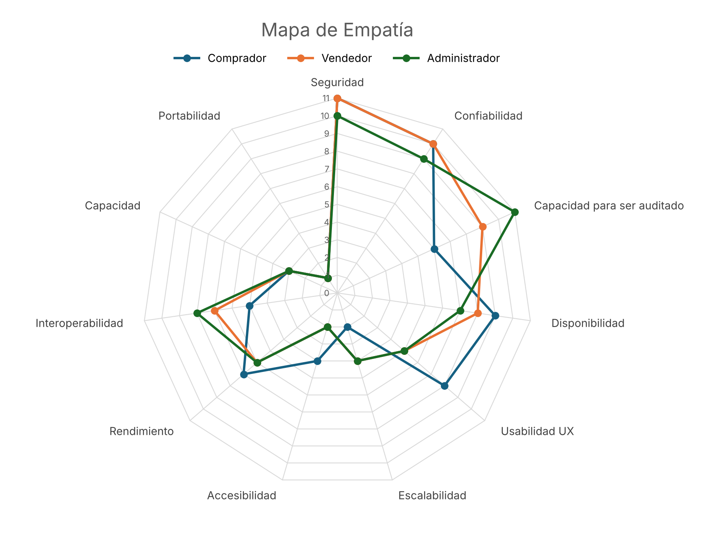

# Documento de arquitectura de DAZMA

## Tabla de contenido

- [1. Propósito del proyecto](#1-propósito-del-proyecto)
- [2. Restricciones](#2-restricciones)
- [3. Drivers arquitectónicos](#3-drivers-arquitectónicos)
- [4. Atributos de calidad y priorización](#4-atributos-de-calidad-y-priorización)
- [5. Matriz de transacción de tiempo](#5-matriz-de-transacción-de-tiempo)
- [6. Escenarios de calidad](#6-escenarios-de-calidad)
- [7. Funcionalidades significativas y tácticas arquitectónicas](#7-funcionalidades-significativas-y-tácticas-arquitectónicas)
- [8. Registros de decisiones arquitectónicas (ADR)](#8-registros-de-decisiones-arquitectónicas-adr)
- [9. Vistas de arquitectura](#9-vistas-de-arquitectura)

## 1. Propósito del proyecto

DAZMA es un marketplace web para el Oriente Antioqueño enfocado en productos usados de valor, como celulares, computadores, consolas, bicicletas, cámaras e instrumentos. Su diferencial es la negociación: el usuario puede cambiar un objeto por otro, agregar una diferencia en dinero o comprar directamente, y todo pasa por el mismo flujo de propuesta, contraoferta, aceptación o cancelación. El dinero que se mueve en la plataforma queda en custodia de un tercero hasta que ambas partes confirman la entrega presencial; entonces se libera al vendedor descontando la comisión de DAZMA, y si la operación se cancela se devuelve al comprador.

## 2. Restricciones

| Documento | Contenido |
|---|---|
| [Restricciones de negocio](RestriccionesNegocio.md) | Restricciones legales, de presupuesto, humanas y de proceso (RN-01 a RN-12). |
| [Restricciones técnicas](RestriccionesT%C3%A9cnicas.md) | Prácticas de diseño, marco metodológico, prácticas DevOps, patrones y prácticas de desarrollo (RT-01 a RT-13). |

[⬆ Volver al índice](#tabla-de-contenido)

## 3. Drivers arquitectónicos

| Sección | Ubicación |
|---|---|
| Requisitos funcionales (47 RF, con impacto al negocio y reto tecnológico) | [DriversArquitectonicos.md § 1](DriversArquitectonicos.md#1-requisitos-funcionales) |
| Funcionalidades críticas y significativas | [DriversArquitectonicos.md § 2](DriversArquitectonicos.md#2-funcionalidades-críticas--significativas) |

[⬆ Volver al índice](#tabla-de-contenido)

## 4. Atributos de calidad y priorización

| Sección | Ubicación |
|---|---|
| Atributos de calidad (implícitos y explícitos) | [DriversArquitectonicos.md  3.0](DriversArquitectonicos.md#3-atributos-de-calidad) |
| Priorización trade-off | [DriversArquitectonicos.md 3.1](DriversArquitectonicos.md#31-priorización-trade-off) |
| Priorización por stakeholders | [DriversArquitectonicos.md  3.2](DriversArquitectonicos.md#32-priorización-por-stakeholders) |

### Mapa de empatía

Muestra cuánto pesa cada atributo de calidad para el comprador, el vendedor y el administrador. Se construye con los votos de la [priorización por stakeholders](DriversArquitectonicos.md#32-priorización-por-stakeholders) y sirvió como insumo para la lluvia de escenarios.

[⬆ Volver al índice](#tabla-de-contenido)

## 5. Matriz de transacción de tiempo

Tiempo máximo de respuesta esperado para cada transacción crítica. El 95% de las solicitudes debe responder dentro de ese valor. Se mide desde que el backend recibe la solicitud hasta que responde.

| ID | Actor | Transacción | Tiempo máximo (s) | Respuesta esperada | Alcance de la medición |
|---|---|---|:---:|---|---|
| TREN-0001 | Vendedor | Crear publicación (RF-09) | 2 | Publicación creada y visible | Sin contar la subida de fotos, que va directo a R2 |
| TREN-0002 | Comprador | Filtrar publicaciones (RF-13) | 2 | Listado filtrado por ciudad, precio o categoría | — |
| TREN-0003 | Comprador | Realizar propuesta (RF-15) | 2 | Propuesta registrada y notificada | El correo se envía después, por la Outbox |
| TREN-0004 | Vendedor / comprador | Contraofertar (RF-16) | 2 | Contraoferta registrada | — |
| TREN-0005 | Vendedor | Aceptar o rechazar propuesta (RF-19) | 2 | Nuevo estado de la propuesta | — |
| TREN-0006 | Comprador | Iniciar pago o compra directa (RF-20, RF-21) | 6 | Redirección al medio de pago | No incluye el tiempo dentro de la pasarela |
| TREN-0007 | Sistema | Registrar la retención tras la confirmación del proveedor (RF-22) | 2 | Pago marcado como retenido | Cuenta desde que llega el webhook |
| TREN-0008 | Comprador / vendedor | Confirmar entrega (RF-42) | 2 | Confirmación registrada | — |
| TREN-0009 | Sistema | Ordenar la liberación del dinero (RF-23) | 2 | Instrucción de liberación registrada | El desembolso real depende de Cobre y Skandia |
| TREN-0010 | Comprador / vendedor | Cancelar propuesta (RF-43) | 2 | Propuesta cancelada | — |
| TREN-0011 | Sistema | Ordenar el reembolso (RF-44) | 2 | Instrucción de reembolso registrada | La devolución real depende del proveedor |
| TREN-0012 | Comprador / vendedor | Calificar usuario (RF-34) | 2 | Calificación registrada | — |
| TREN-0013 | Usuario | Consultar el historial de un usuario (RF-36) | 3 | Historial paginado | — |
| TREN-0014 | Usuario | Consultar reputación (RF-37) | 2 | Promedio y número de calificaciones | — |
| TREN-0015 | Usuario | Enviar mensaje en el chat | 2 | Mensaje recibido por la otra parte | Viene de [REN-0010](DriversArquitectonicos.md#esc-cal-ren-0010-1) |

[⬆ Volver al índice](#tabla-de-contenido)

## 6. Escenarios de calidad

El proceso completo para llegar a los escenarios finales está en Drivers:

- [Lluvia de escenarios, ronda 1](DriversArquitectonicos.md#4-lluvia-de-escenarios--ronda-1), con votación por puntos (dot voting).
- [Resultado de la ronda 1](DriversArquitectonicos.md#5-resultado-de-ronda-1) y [especificación de los escenarios que pasan a la ronda 2](DriversArquitectonicos.md#51-especificación-de-los-escenarios-que-pasan-a-ronda-2).
- [Ronda 2](DriversArquitectonicos.md#6-ronda-2) y [escenarios seleccionados](DriversArquitectonicos.md#61-escenarios-seleccionados-en-ronda-2).

Los 12 [escenarios de calidad finales](DriversArquitectonicos.md#7-escenarios-de-calidad-finales) son:

| Escenario | Atributo | Resumen |
|---|---|---|
| [ESC-CAL-SEG-0004](DriversArquitectonicos.md#esc-cal-seg-0004-1) | Seguridad | Impedir que usuarios no autorizados accedan, consulten o modifiquen información y recursos que no les pertenecen. |
| [ESC-CAL-SEG-0008](DriversArquitectonicos.md#esc-cal-seg-0008-1) | Seguridad | Ejecutar las operaciones críticas solo con identidad y permisos válidos, sin exponer información secreta. |
| [ESC-CAL-CON-0001](DriversArquitectonicos.md#esc-cal-con-0001-1) | Confiabilidad | Conservar un único estado válido, sin cambios parciales, si ocurre una falla durante una negociación u operación económica. |
| [ESC-CAL-CON-0005](DriversArquitectonicos.md#esc-cal-con-0005-1) | Confiabilidad | Una notificación de pago repetida produce un único efecto económico y un único cambio de estado. |
| [ESC-CAL-CON-0010](DriversArquitectonicos.md#esc-cal-con-0010-1) | Confiabilidad | Detectar y mitigar señales de saturación o degradación antes de que el servicio se interrumpa. |
| [ESC-CAL-CON-0011](DriversArquitectonicos.md#esc-cal-con-0011-1) | Confiabilidad | Contener la falla de un servicio secundario o externo sin detener los flujos críticos que no dependen de él. |
| [ESC-CAL-AUD-0008](DriversArquitectonicos.md#esc-cal-aud-0008-1) | Capacidad para ser auditado | Reconstruir cronológicamente los eventos críticos de una negociación ante una reclamación. |
| [ESC-CAL-DIS-0006](DriversArquitectonicos.md#esc-cal-dis-0006-1) | Disponibilidad | Mantener la indisponibilidad de los flujos críticos dentro del máximo definido durante despliegues y mantenimientos. |
| [ESC-CAL-USA-0006](DriversArquitectonicos.md#esc-cal-usa-0006-1) | Usabilidad UX | Que el usuario entienda qué entrega, qué recibe y si hay dinero adicional antes de decidir sobre una propuesta. |
| [ESC-CAL-ESC-0003](DriversArquitectonicos.md#esc-cal-esc-0003-1) | Escalabilidad | Absorber un aumento temporal de usuarios y solicitudes o degradarse de forma controlada, sin caída general. |
| [ESC-CAL-REN-0010](DriversArquitectonicos.md#esc-cal-ren-0010-1) | Rendimiento | Los mensajes de una negociación llegan a la otra parte en un máximo de 2 segundos bajo la carga objetivo. |
| [ESC-CAL-INT-0002](DriversArquitectonicos.md#esc-cal-int-0002-1) | Interoperabilidad | Intercambiar información con proveedores externos sin acoplar las reglas del negocio a una implementación concreta. |

[⬆ Volver al índice](#tabla-de-contenido)

## 7. Funcionalidades significativas y tácticas arquitectónicas

Cada bloque agrupa [funcionalidades críticas](DriversArquitectonicos.md#2-funcionalidades-críticas--significativas) que comparten problema de diseño y explica qué tácticas lo resuelven, qué escenarios atienden y en qué ADR se decidieron.

### 7.1 Negociación: propuesta, contraoferta, aceptación y cancelación

**Funcionalidades:** RF-15, RF-16, RF-19, RF-43 · **Escenarios:** [CON-0001](DriversArquitectonicos.md#esc-cal-con-0001-1), [CON-0005](DriversArquitectonicos.md#esc-cal-con-0005-1), [USA-0006](DriversArquitectonicos.md#esc-cal-usa-0006-1), [SEG-0004](DriversArquitectonicos.md#esc-cal-seg-0004-1) · **ADR:** [ADR-03](docs/adr-03-ConsistenciaDeEstado.md), [ADR-01](docs/adr-01-EstrategiaDeAutorizacion.md), [ADR-05](docs/adr-05-RegistroAuditable.md)

Cada propuesta avanza por una máquina de estados explícita: solo se aceptan transiciones válidas, como aceptar una propuesta pendiente pero no una cancelada, y cada cambio se guarda en una sola transacción, de modo que nunca queda a medias. Si las dos partes actúan al mismo tiempo, el control de concurrencia deja pasar solo una acción y la otra recibe un error claro. Las solicitudes repetidas llevan un identificador que impide aplicar dos veces el mismo efecto. Antes de cualquier acción, el backend comprueba que el usuario participa en esa negociación, y cada cambio queda en el registro auditable.

### 7.2 Confirmación de entrega

**Funcionalidades:** RF-42 · **Escenarios:** [CON-0001](DriversArquitectonicos.md#esc-cal-con-0001-1), [CON-0005](DriversArquitectonicos.md#esc-cal-con-0005-1) · **ADR:** [ADR-03](docs/adr-03-ConsistenciaDeEstado.md)

Es la transición más delicada, porque las dos partes pueden confirmar casi al mismo tiempo y la segunda confirmación habilita la liberación del dinero. El control de concurrencia asegura que ambas confirmaciones queden registradas y que la liberación se ordene una sola vez. Una confirmación repetida no cambia el estado.

### 7.3 Pago y retención del dinero

**Funcionalidades:** RF-20, RF-21, RF-22 · **Escenarios:** [SEG-0008](DriversArquitectonicos.md#esc-cal-seg-0008-1), [CON-0001](DriversArquitectonicos.md#esc-cal-con-0001-1), [CON-0005](DriversArquitectonicos.md#esc-cal-con-0005-1), [INT-0002](DriversArquitectonicos.md#esc-cal-int-0002-1) · **ADR:** [ADR-09](docs/adr-09-IntegracionConProveedores.md), [ADR-17](docs/adr-17-InfraestructuraDePagos.md), [ADR-28](docs/adr-28-ModeloFiduciario.md), [ADR-21](docs/adr-21-MensajeriaAsincrona.md)

DAZMA no guarda el dinero: el recaudo lo hace Cobre y la custodia Skandia, bajo un contrato fiduciario. El dominio se comunica con ellos mediante un puerto propio y un adaptador por proveedor, así que cambiar de proveedor no toca las reglas de negociación. Cada instrucción de pago lleva una clave de idempotencia, y las confirmaciones llegan por webhooks cuya firma se verifica y que se descartan si ya fueron procesados. El cambio de estado y las tareas que dependen de él, como avisar a las partes, se guardan en la misma transacción mediante la Outbox.

### 7.4 Liberación y reembolso

**Funcionalidades:** RF-23, RF-44 · **Escenarios:** [CON-0005](DriversArquitectonicos.md#esc-cal-con-0005-1), [CON-0011](DriversArquitectonicos.md#esc-cal-con-0011-1), [AUD-0008](DriversArquitectonicos.md#esc-cal-aud-0008-1) · **ADR:** [ADR-16](docs/adr-16-ResilienciaAnteFallas.md), [ADR-28](docs/adr-28-ModeloFiduciario.md), [ADR-30](docs/adr-30-ConciliacionFinanciera.md), [ADR-05](docs/adr-05-RegistroAuditable.md)

Una respuesta lenta del proveedor no puede convertirse en un segundo pago, por eso antes de reintentar DAZMA consulta el estado de la instrucción por su referencia. Los reintentos son limitados y un Circuit Breaker corta las llamadas cuando el proveedor está caído, dejando la operación en un estado controlado que se completa cuando se recupera. Cada movimiento queda en un registro financiero de solo adición que se concilia periódicamente con Cobre, Skandia y el banco; las diferencias quedan abiertas hasta que alguien las revise.

### 7.5 Publicar y filtrar

**Funcionalidades:** RF-09, RF-13 · **Escenarios:** [ESC-0003](DriversArquitectonicos.md#esc-cal-esc-0003-1), [SEG-0004](DriversArquitectonicos.md#esc-cal-seg-0004-1) · **ADR:** [ADR-12](docs/adr-12-AlmacenamientoDeArchivos.md), [ADR-13](docs/adr-13-ServicioDeBlobStorage.md), [ADR-32](docs/adr-32-SeguridadDeArchivos.md), [ADR-33](docs/adr-33-MemoriaCache.md), [ADR-34](docs/adr-34-ApiGateway.md)

El backend solo entrega un enlace firmado de carga a quien está autorizado, y con él las fotos viajan del navegador a Cloudflare R2 sin pasar por el backend. Antes de publicarse, las imágenes se recodifican para eliminar contenido inesperado y metadatos de ubicación, con un tope de megapíxeles que se revisa antes de decodificarlas. Las consultas frecuentes se sirven desde una caché compartida para aliviar la base de datos en los picos, y el API Gateway limita las ráfagas de solicitudes antes de que lleguen al backend.

### 7.6 Confianza: calificación, historial y reputación

**Funcionalidades:** RF-34, RF-36, RF-37 · **Escenarios:** [AUD-0008](DriversArquitectonicos.md#esc-cal-aud-0008-1) · **ADR:** [ADR-05](docs/adr-05-RegistroAuditable.md), [ADR-10](docs/adr-10-ParadigmaDeBaseDeDatos.md)

La reputación se construye con operaciones finalizadas que quedan registradas y no se modifican, de modo que el historial de un usuario se puede reconstruir y no se puede maquillar. Las restricciones de unicidad de la base relacional evitan registros duplicados.

### 7.7 Permisos por rol y propiedad

**Funcionalidades:** RF-06 · **Escenarios:** [SEG-0004](DriversArquitectonicos.md#esc-cal-seg-0004-1), [SEG-0008](DriversArquitectonicos.md#esc-cal-seg-0008-1) · **ADR:** [ADR-01](docs/adr-01-EstrategiaDeAutorizacion.md), [ADR-02](docs/adr-02-ProveedorDeIdentidad.md)

La identidad la confirma Firebase y la sesión la controla el backend, que puede revocarla. Lo que cada usuario puede hacer lo decide DAZMA: todo está denegado por defecto, el rol habilita las acciones generales y la propiedad del recurso define sobre qué publicaciones o negociaciones puede actuar.

### 7.8 Toda la plataforma: carga, fallas y despliegues

**Funcionalidades:** No depende de una funcionalidad: aplica a todas · **Escenarios:** [ESC-0003](DriversArquitectonicos.md#esc-cal-esc-0003-1), [CON-0010](DriversArquitectonicos.md#esc-cal-con-0010-1), [CON-0011](DriversArquitectonicos.md#esc-cal-con-0011-1), [DIS-0006](DriversArquitectonicos.md#esc-cal-dis-0006-1) · **ADR:** [ADR-14](docs/adr-14-ProteccionConWAF.md), [ADR-34](docs/adr-34-ApiGateway.md), [ADR-04](docs/adr-04-AlertasDeAltoConsumo.md), [ADR-29](docs/adr-29-Observabilidad.md), [ADR-16](docs/adr-16-ResilienciaAnteFallas.md), [ADR-06](docs/adr-06-EstrategiaDeDespliegue.md), [ADR-36](docs/adr-36-PipelineCICD.md)

El tráfico pasa primero por el WAF y luego por el API Gateway, que limita las avalanchas de solicitudes. El backend escala hasta un número máximo de instancias y las alertas avisan antes de que la carga provoque una caída. Si un servicio externo falla, los Circuit Breakers aíslan esa dependencia y el resto de los flujos sigue operando. Las versiones nuevas pasan por los controles del pipeline de CI/CD y se despliegan de forma gradual, con comprobación de salud y vuelta atrás.

[⬆ Volver al índice](#tabla-de-contenido)

## 8. Architecture Decision Records

Cada ADR está en su propio archivo dentro de [`docs/`](docs/). Todos están en estado *Accepted*.

| ADR | Decisión |
|---|---|
| [ADR-01](docs/adr-01-EstrategiaDeAutorizacion.md) | Estrategia de autorización para recursos y operaciones críticas |
| [ADR-02](docs/adr-02-ProveedorDeIdentidad.md) | Adopción de un proveedor de identidad |
| [ADR-03](docs/adr-03-ConsistenciaDeEstado.md) | Consistencia de estado en operaciones críticas |
| [ADR-04](docs/adr-04-AlertasDeAltoConsumo.md) | Alertas en momentos de alto consumo para mitigar a tiempo los fallos del sistema antes de una caída general |
| [ADR-05](docs/adr-05-RegistroAuditable.md) | Registro auditable de eventos críticos del negocio |
| [ADR-06](docs/adr-06-EstrategiaDeDespliegue.md) | Estrategia de despliegue con mínima indisponibilidad |
| [ADR-07](docs/adr-07-ComunicacionEnTiempoReal.md) | Estrategia de comunicación en tiempo real para negociaciones |
| [ADR-08](docs/adr-08-ProveedorDeChat.md) | Selección del proveedor externo de chat |
| [ADR-09](docs/adr-09-IntegracionConProveedores.md) | Estrategia de integración con proveedores externos |
| [ADR-10](docs/adr-10-ParadigmaDeBaseDeDatos.md) | Selección del paradigma de la base de datos: Relacional o no relacional |
| [ADR-11](docs/adr-11-MotorDeBaseDeDatos.md) | Selección del motor de base de datos relacional para el núcleo transaccional |
| [ADR-12](docs/adr-12-AlmacenamientoDeArchivos.md) | Almacenamiento de imágenes y archivos de publicaciones |
| [ADR-13](docs/adr-13-ServicioDeBlobStorage.md) | Selección del servicio de Blob Storage |
| [ADR-14](docs/adr-14-ProteccionConWAF.md) | Protección de la aplicación web mediante WAF |
| [ADR-15](docs/adr-15-NotificationGateway.md) | Selección de un notification gateway |
| [ADR-16](docs/adr-16-ResilienciaAnteFallas.md) | Resiliencia frente a fallas parciales y dependencias degradadas |
| [ADR-17](docs/adr-17-InfraestructuraDePagos.md) | Infraestructura de pagos para recaudo y desembolso |
| [ADR-18](docs/adr-18-FrameworkFrontend.md) | Framework y modelo de renderizado para la aplicación web |
| [ADR-19](docs/adr-19-FrameworkBackend.md) | Lenguaje y framework para el backend de DAZMA |
| [ADR-20](docs/adr-20-EstiloDeAPI.md) | Estilo de API y contrato entre frontend, backend e integraciones |
| [ADR-21](docs/adr-21-MensajeriaAsincrona.md) | Estrategia de mensajería asíncrona y procesamiento diferible |
| [ADR-22](docs/adr-22-PlataformaDeDespliegue.md) | Modelo de ejecución y plataforma de despliegue |
| [ADR-23](docs/adr-23-PaasFrontend.md) | Plataforma como servicio (PaaS) para el despliegue del frontend de la plataforma |
| [ADR-24](docs/adr-24-PaasBackend.md) | Plataforma como servicio (PaaS) para el despliegue del backend de la plataforma |
| [ADR-25](docs/adr-25-GestionDeSecretos.md) | Gestión de secretos y credenciales técnicas |
| [ADR-26](docs/adr-26-TipoDeAplicacion.md) | Definición del tipo de aplicación (Reactiva/No reactiva/Ambas) |
| [ADR-27](docs/adr-27-EstiloArquitectonico.md) | Definición del estilo arquitectónico |
| [ADR-28](docs/adr-28-ModeloFiduciario.md) | Modelo fiduciario para administrar y liberar pagos |
| [ADR-29](docs/adr-29-Observabilidad.md) | Adopción de herramienta de observabilidad y monitoreo |
| [ADR-30](docs/adr-30-ConciliacionFinanciera.md) | Conciliación financiera y control de movimientos |
| [ADR-31](docs/adr-31-CopiasDeSeguridad.md) | Copias de seguridad, restauración y recuperación ante desastres |
| [ADR-32](docs/adr-32-SeguridadDeArchivos.md) | Seguridad y ciclo de vida de archivos |
| [ADR-33](docs/adr-33-MemoriaCache.md) | Selección de una alternativa para memoria caché |
| [ADR-34](docs/adr-34-ApiGateway.md) | Selección del API Gateway |
| [ADR-35](docs/adr-35-ProveedorDeBaulDeSecretos.md) | Selección del proveedor del baúl de secretos |
| [ADR-36](docs/adr-36-PipelineCICD.md) | Plataforma de integración y entrega continuas (CI/CD) |

[⬆ Volver al índice](#tabla-de-contenido)

## 9. Modelos de arquitectura

| Vista | Archivo |
|---|---|
| Modelo de contexto (C4, nivel de contenedores) | [ContextModel.svg](ContextModel.svg) |
| Diagrama de componentes | [DiagramaDeComponentes.svg](DiagramaDeComponentes.svg) |
| Diagrama de paquetes | [DiagramaDePaquetes.svg](DiagramaDePaquetes.svg) |
| Diagrama de secuencia | [DiagramaDeSecuencia.svg](DiagramaDeSecuencia.svg) |

[⬆ Volver al índice](#tabla-de-contenido)
